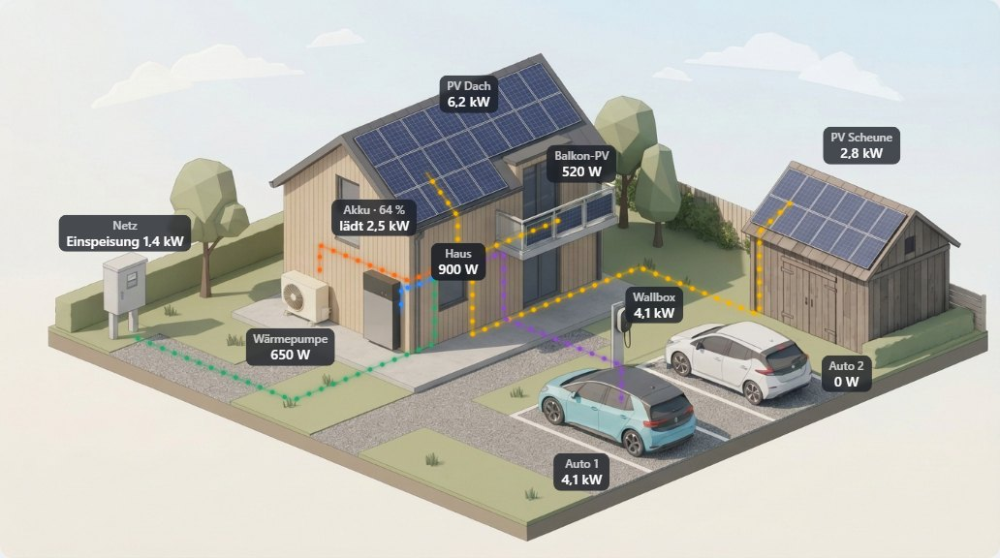

# Unique Energy Card

A Home Assistant dashboard card that shows live energy flows — PV, grid, home
battery, heat pump, wallbox and up to two cars — as animated dots over a
low-poly isometric picture of a house.



The picture is built from layers: a base image plus one transparent PNG per
optional component, so anything you don't have (battery, barn with PV, second
car, …) simply disappears from the picture. The card ships with a graphical
editor and speaks **German, English, Spanish and French**.

## Installation (HACS)

1. HACS → ⋮ → *Custom repositories* → `https://github.com/bamamelnik/ha-unique-energy`, type *Dashboard*.
2. Download *Unique Energy Card*. HACS registers the resource
   `/hacsfiles/ha-unique-energy/ha-unique-energy.js` for you.
3. Add the card *Unique Energy Card* to a dashboard and configure it in the editor.

## Configuration

```yaml
type: custom:unique-energy-card
images: /hacsfiles/ha-unique-energy/lowpoly   # image set shipped with the card
title: Energy                                 # optional
language: auto                                # auto (follows Home Assistant), de, en, es, fr
grid:       { power: sensor.grid_power, price: sensor.electricity_price, cost: sensor.cost_today }   # + = import, − = export
home:       { power: sensor.house_power, subtract: sensor.wallbox_power,
              consumers: [sensor.oven_power, { entity: sensor.washer_power, name: Washer }] }
pv_roof:    { power: sensor.pv_roof_power, string_1: sensor.pv_dc1, string_2: sensor.pv_dc2 }
pv_balcony: { power: sensor.balcony_pv_power }
barn:       { power: sensor.barn_pv_power }          # barn including its PV
battery:    { power: sensor.battery_power, soc: sensor.battery_soc, soc_min: number.battery_min_soc }   # + = charging
heat_pump:  { power: sensor.heat_pump_power }
wallbox:    { power: sensor.wallbox_power }
car_1:      { name: My car, soc: sensor.car_soc }    # without power: uses the wallbox
car_2:      { power: sensor.car2_power }
```

A component is shown when its key is present and does not carry `show: false`.
Grid and home are part of the base image.

| Key | Meaning |
|---|---|
| `power` | power sensor; W, kW and MW are read from `unit_of_measurement` |
| `invert` | `true` flips the sign |
| `subtract` | entity (or list) subtracted before the sign is applied; if one is unavailable the card shows “–” |
| `soc` | state of charge in % (battery, cars) |
| `soc_min` | battery only: minimum state of charge (sensor, `number` or `input_number`), shown next to the SOC |
| `price`, `cost` | grid only: electricity price per kWh and today's cost (e.g. from Tibber), shown in a fine line below the value; `EUR` is shown as `€` |
| `consumers` | home only: list of power sensors (or `{ entity, name }`); the three largest active ones are shown below the house value. Without a name the friendly name is used, minus a trailing “power” |
| `string_1` … `string_3` | PV only: up to three string sensors, shown in a smaller line above the total; without `power` their sum is the total |
| `name` | label text; without it the card uses the translated default |
| `show` | `false` hides the component but keeps its settings |

`battery` may also be a list of batteries (summed); the editor leaves such a list
untouched, edit it in YAML.

### Upgrading from 0.5 and earlier

Up to 0.5 the card was called `custom:hos-energiekarte` and used German keys
(`bilder`, `netz`, `leistung`, …). Both still work: the card reads them, and
the editor writes the configuration back with the new type and English keys the
next time you save it. The image files were renamed in 0.6.0 — keep
`images` pointing at the folder, not at single files.

## Development

No build step — `dist/ha-unique-energy.js` is the source.

| Path | Purpose |
|---|---|
| `dist/ha-unique-energy.js` | the card and its editor; layouts live in a JSON block inside |
| `dist/lowpoly/` | runtime images: `base.jpg` + 8 PNG layers with alpha, all 1376 × 768 |
| `sources/lowpoly/` | the four generated source images the layers are cut from |
| `tools/cut_layers.py` | recreates `dist/lowpoly/` from `sources/lowpoly/` (needs numpy, Pillow, scipy) |
| `tools/path_preview.py` | draws paths and label anchors of a layout onto the full image |
| `dev/prototype.html` | the real card with simulated values, switches, scenes and a language switch |
| `dev/card-test.html` | tests card and editor against a stand-in `ha-form` |

Open the HTML files directly in a browser (headless Chrome needs
`--allow-file-access-from-files` for the images).

```bash
python -I tools/cut_layers.py sources/lowpoly dist/lowpoly
python -I tools/path_preview.py dist/ha-unique-energy.js sources/lowpoly/low-poly_full.jpg preview.png
```

Paths are in image pixels, only `M L Q C`, and run **from the component to the
node** at the house. The layout block must stay valid JSON.

**Release:** bump `VERSION` in the card (it is also appended to image URLs),
run the test, commit, then publish a GitHub release `v<VERSION>` — HACS needs a
release, a tag alone is not enough.

## License

MIT, see [LICENSE](LICENSE).
